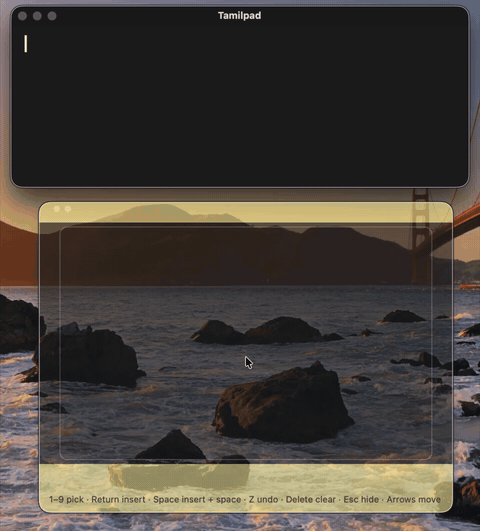

# Tamil Handwriting for Mac (test version)

Write Tamil with your finger on a MacBook trackpad, and the letters are typed into whatever app you're using: Notes, Mail, Pages, a web browser and more. It also has **Tamilpad**, a small notepad of its own.

This is a free test version for friends. **It works until 31 December 2026.** Please tell us what works and what doesn't: see [Feedback](#feedback).

## What you need

- A Mac with an Apple chip (M1 or later) and macOS 14 Sonoma or later
- A trackpad (built-in, or a Magic Trackpad)
- An internet connection while you write

## Install

1. Download **TamilHandwriting-0.8.1-test.dmg** from the [latest release](https://github.com/kazhugu/Tamil_Handwriting_Beta/releases/latest).
2. Open it, and drag **Tamil Handwriting** onto the **Applications** folder.
3. **Allow the app once.** It isn't registered with Apple yet, so macOS blocks it the first time. This takes a few steps, and the first message has no button to open the app; that's expected.

   **macOS 15 Sequoia or later:**
   1. Open **Tamil Handwriting** from Applications. A message says Apple could not verify it. Click **Done**, not Move to Trash.
   2. Open **System Settings → Privacy & Security** and scroll right down to the **Security** section.
   3. You'll see that Tamil Handwriting was blocked. Click **Open Anyway** next to it, and enter your password or use Touch ID. The button only appears after step 1, and only for about an hour, so if it isn't there, do step 1 again.
   4. A second message appears. Click **Open Anyway** again. If nothing happens, open the app from Applications once more.

   **macOS 14 Sonoma:** right-click the app in Applications, choose **Open**, then click **Open** in the message.

   You only do this once. Still stuck? See [if macOS won't open the app](USER_GUIDE.md#if-macos-wont-open-the-app).
4. A welcome window appears, and **த** appears in the menu bar. Click **Start Writing** to try it in Tamilpad.
5. To write in other apps, click **Allow Typing into Other Apps…** and switch on **Tamil Handwriting** in the Accessibility list. You only do this once.

Everything else is in the [user guide](USER_GUIDE.md).

## Your privacy

To recognise your writing, the app sends the **shape of your strokes** to Google's handwriting service. Nothing else is sent: not what you type with the keyboard, not your files, and not what's in Tamilpad. The Accessibility permission is only used to type the letters you pick.

## Feedback

The app's **த → Send Feedback…** menu item brings you here.

- **With a GitHub account:** [open a feedback form](https://github.com/kazhugu/Tamil_Handwriting_Beta/issues/new/choose). GitHub asks you to sign in first.
- **Without one:** use the [Google feedback form](https://docs.google.com/forms/d/e/1FAIpQLSfVVl_TINH5-7tOrDqudI4klDLuxmiZsBYwLp0EUPymSBA5hA/viewform) instead.

Useful things to tell us: letters it often gets wrong, apps where typing doesn't work, anything confusing during setup, and whether you'd use it every day.

## After 31 December

The writing pad stops working. Tamilpad still opens, so you won't lose anything you wrote there. You can then [uninstall](USER_GUIDE.md#uninstall) the app.
