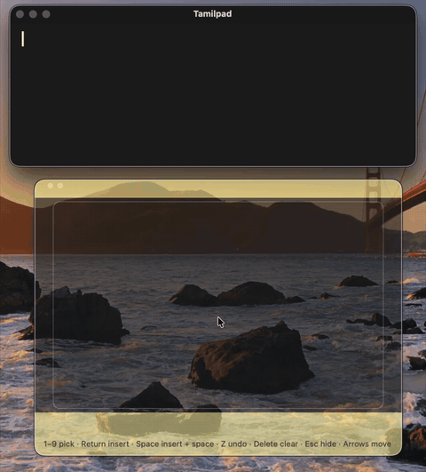
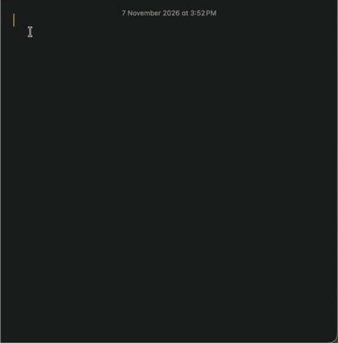

# Tamil Handwriting user guide

Test version 0.8.1, working until 31 December 2026.

- [Install and first start](#install-and-first-start)
- [Writing](#writing)
- [Keys](#keys)
- [Tamilpad](#tamilpad)
- [Writing in other apps](#writing-in-other-apps)
- [Numbers and symbols](#numbers-and-symbols)
- [Letters that look alike](#letters-that-look-alike)
- [Settings](#settings)
- [Problems and fixes](#problems-and-fixes)
- [Uninstall](#uninstall)

## Install and first start

Follow the [install steps](README.md#install). Then:

- **Welcome window:** it lists the main keys, and appears once for each new version. Open it again any time from **த → Welcome and Shortcuts…**.
- **Menu bar:** look for **த** near the clock. Everything the app does starts from there.
- **At login:** the app starts by itself, quietly, with just **த** in the menu bar. To stop that, turn it off in **System Settings → General → Login Items** (called **Login Items & Extensions** on newer macOS), under **Allow in the Background**.

<!-- screenshot: guide/images/welcome.png -->

## Writing

1. Press **⌃⌥T** (Control, Option and T together) from any app, or choose **த → Show Writing Pad**. Opening the app from Applications opens Tamilpad with the pad over it.
2. Write on the trackpad with **one finger and a light touch, without clicking**. The whole trackpad is the writing area. While the pad is open, the pointer stays still.
3. Write a letter or a whole word, left to right. For a dot (pulli, ்), tap once.
4. Stop for about a second. Suggestions appear at the bottom of the pad, best first.
5. Press **Return** for the first suggestion, **Space** for the first suggestion and a space, or **1–9** for another one.
6. Press **Esc** when you're done. The pointer moves again.

**Examples,** drawn at the speed they were written on a trackpad:

| | | |
|---|---|---|
|  |  |  |
| One stroke | The pulli is a quick tap | The ா is a second stroke |
|  |  |  |
| ெ, then க, then ா | A whole word, left to right | Longer words work too |

**The whole flow in Tamilpad:** writing அகர முதல எழுத்தெல்லாம், one word at a time, with Space after each.



[Watch it as a video](guide/videos/writing-in-tamilpad.mp4)

**Tips:**
- Write a bit larger than you'd write on paper. Using most of the trackpad works best.
- Whole words are often recognised better than single letters.
- Made a mistake? **Z** removes the last stroke, and **Delete** clears the pad.

## Keys

| Key | What it does |
|---|---|
| ⌃⌥T | Show or hide the pad, from any app |
| Return | Insert the first suggestion. With an empty pad, a new line |
| Space | Insert the first suggestion and a space. With an empty pad, a space |
| 1–9 | Insert that suggestion. With an empty pad, type the number |
| Z | Undo the last stroke |
| Delete | Clear the pad. With an empty pad, delete the letter before the cursor |
| Arrow keys | Move the pad. It stays where you leave it |
| Esc | Hide the pad and free the pointer |

## Tamilpad

Tamilpad is a small notepad inside the app. It's the easiest place to start, because it needs no permission.

- **Opening it:** choose **த → Open Tamilpad**, click **Start Writing** in the welcome window, or open the app from Applications.
- **The cursor:** while you write on the pad, a yellow cursor (amber in light mode) shows where the next word goes. Click into Tamilpad to type with the keyboard, and the cursor blinks.
- **Your text:** it's saved as you go and kept between launches. To use it elsewhere, select it (⌘A), copy it (⌘C) and paste it where you like.
- **Closing it:** press ⌘W.

## Writing in other apps

1. Allow typing once: **த → Allow Typing into Other Apps…**, then switch on **Tamil Handwriting** in **System Settings → Privacy & Security → Accessibility**. macOS may ask for your password.
2. Click where you want to type in the other app, then press **⌃⌥T**.
3. Write and pick as usual. The letters appear in that app.

**In Notes:** writing ஞாயிறு திங்கள், with the pad over a new note.



[Watch it as a video](guide/videos/writing-in-notes.mp4)

Without the permission, the letters you pick are copied instead, so you can paste them with ⌘V.

## Numbers and symbols

- **Numbers:** with nothing written on the pad, press the number keys. With writing on the pad, 1–9 pick suggestions, so pick first.
- **Symbols:** press the key, such as , . ? ! - ( ). You can also write a symbol: a single tap is a full stop, and a short flat line is a hyphen.
- **Spaces:** a space is added after , . ; : ? ! ) ] } so you don't need to press Space after them.


## Letters that look alike

Some letters are hard to tell apart from their shape, for example **ஷு** and **ஷீ**, or **ஹு** and **ஹீ**. If the first suggestion is wrong, look along the list and press its number; the right letter is usually second or third.


## Settings

- **Pad opacity:** **த → Pad Opacity** makes the pad more or less see-through.
- **Pad position:** move it with the arrow keys while it's open.

## Problems and fixes

| Problem | Fix |
|---|---|
| macOS says the app can't be opened | Allow it once in System Settings → Privacy & Security → **Open Anyway** (see [Install](README.md#install) and [below](#if-macos-wont-open-the-app)). |
| Nothing is drawn when I write | Use a light touch without clicking, and make sure the pad is in front: press ⌃⌥T. |
| Letters are copied instead of typed | Allow typing: **த → Allow Typing into Other Apps…** |
| Typing stopped working after an update | In System Settings → Privacy & Security → Accessibility, remove Tamil Handwriting with **–**, then add it again. |
| "Couldn't recognise" | Check your internet connection. |
| The pad says to press ⌃⌥T to keep writing | Press ⌃⌥T. macOS sometimes doesn't hand focus back straight away. |
| ⌃⌥T does nothing | Check that **த** is in the menu bar. If not, open the app from Applications. |

Something else? Please [send feedback](README.md#feedback).

### If macOS won't open the app

The usual reason is that the **Open Anyway** button has gone: it appears in System Settings → Privacy & Security only after you've tried to open the app, and only for about an hour. Open the app from Applications again, click **Done**, then go straight to System Settings.

If that still doesn't work, you can tell macOS you trust this download using Terminal. Only do this for apps you trust, such as this one from a friend:

1. Open **Terminal** (in Applications → Utilities).
2. Paste this line and press Return:

   ```
   xattr -dr com.apple.quarantine "/Applications/Tamil Handwriting.app"
   ```

3. Open Tamil Handwriting from Applications as usual.

## Uninstall

1. Choose **த → Quit Tamil Handwriting**.
2. Drag **Tamil Handwriting** from Applications to the Trash (Bin).
3. In **System Settings → General → Login Items** (called **Login Items & Extensions** on newer macOS), under **Allow in the Background**, turn off Tamil Handwriting if it's still listed.
4. In **System Settings → Privacy & Security → Accessibility**, remove Tamil Handwriting with **–**.
5. Optional: to delete Tamilpad's text, delete the folder `~/Library/Application Support/TamilHandwriting`.
